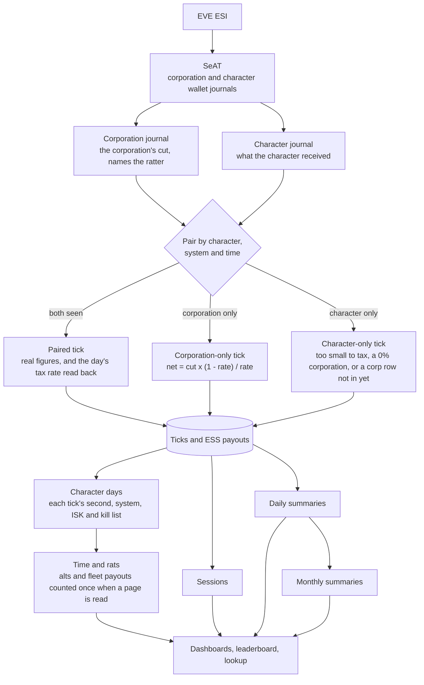

# Ratting Manager for SeAT

[](LICENSE)
[](https://github.com/eveseat/seat)

A ratting plugin for SeAT 5.x. It tracks one thing: who rats, where, when, how much they earn and what they kill. Every member sees their own ratting, and directors see the same for the whole corporation.

Ratting Manager 1.0 is in preparation.

Release history lives in the [CHANGELOG](CHANGELOG.md).

## Features

- **My Ratting** -- Every member's own page: ratting income, ISK per hour, hours, rats killed, active days, their rank by hours and the corporation tax their ratting paid, for this month, last month, the last 30 or 90 days, the last 12 months, any of the 11 calendar months before this one or a custom range of days within the last year, across all their characters or one of them. Charts of income by month and by day, where they rat, what they kill by faction and by size, a weekday by hour map of when they rat in EVE time, bounty ISK per hour for each session, income by character, recent sessions, special spawns and personal records over the last 12 months (best tick, session, day and month, longest session).
- **Insights** -- Where, when and how well, on My Ratting and the Corporation tab: favourite and best-paying system, most active and best-paying day of the week, most active and best-paying three hours of the day in EVE time, ratting streaks, typical and longest session, rats per hour, favourite target and how much of the income came from the ESS. Charts of hours by day of the week and by hour of the day, ISK per hour by system, and a table of every system ratted with its hours, share of the time, income, ISK per hour, rats and days. Directors also see the most players ratting at once, players per active day, income per player, and for each system how many players ratted there and who ratted there most.
- **Month by character** -- What each of a member's characters earned in a month (bounties, ESS, corporation tax, hours, ISK per hour, ticks and rats) with the month's total for all of them, and each character's income month by month.
- **Month by month** *(Director)* -- For the last 12 months: what the players earned, what landed in the corporation's wallet and the tax rate that makes, how many players and characters ratted, hours, ISK per hour and income per player, with a chart of earned against taxed.
- **Monthly Report** *(Director)* -- One calendar month for the corporation's books: ISK ratted, the corporation's cut, what the pilots received, how many systems, constellations and regions it covers, the top systems, and everyone who ratted for it that month, biggest first, with a CSV download. A past month still lists the people who have left since, marked as ex-members with the day they left.
- **Ex-members** -- Ratting counts for the corporation a character was in at the time, so a player who leaves stays on the boards for the periods they ratted, marked as an ex-member with exactly when they left, read from EVE's corporation history, and their last tick. Everyone who rats is watched for leaving, token or no token. See [Who has left](#who-has-left).
- **Not authed with SeAT** -- A badge on a player with no live token, saying whether they were never added or have lost every token. They still count, from the corporation journal.
- **Lost wallet tokens** -- A token that is lost or revoked costs nothing while the corporation journal covers it, and up to 30 days fill in by themselves on the next import once it is back. Directors see who has lost one and the last day that loses nothing, and an alert says so before ESI's 30 days run out.
- **Corporation tab** *(Director)* -- A second tab on the Dashboard, in sections for an overview, players, when, where, kills and month by month, with the corporation's ISK ratted, totals and the corporation's cut, the median ISK per hour, how much of the ratting is tracked, a leaderboard, income by month and by day, who earns the income, when the corporation rats, active ratters per month, ratters coming and going (new, back after a gap, still ratting, stopped), efficiency by system, what the corporation kills, untracked ratters, players who have gone quiet, and special spawns. It opens on all tracked corporations, with any one of them a pick away.
- **Leaderboard** -- Members see their corporation ranked by hours ratted, with active days and their own row picked out, and nobody's ISK. Directors see every column: ISK ratted, income, hours, ISK per hour, ISK per hour against the median player, rats, active days, the change on the period before, and coverage, and can download it as a CSV. A player none of whose characters is in the corporations shown any more is tagged as an ex-member with the day they left, since their ratting still counts where they earned it.
- **Charts that explain themselves** -- Every chart has a line under it saying what it shows.
- **Full lists** -- The dashboards show the first 10 rows of each long list (sessions, systems, special spawns, untracked ratters, players gone quiet, the leaderboard); **View all** opens the whole list on its own page, searchable and sortable, keeping the period, character or corporation picked.
- **Ratter Lookup** *(Director)* -- Every player who ratted in the last 90 days, searchable, each opening onto their ratting as they see it, with their rank by hours, plus where each of their characters' figures come from.
- **Members with no wallet token still count.** The corporation journal names the ratter on every tick it taxes, so a member who never added a wallet token still shows up, with their time exact and their income worked out exactly from the corporation's cut. They are listed under Untracked ratters so directors can ask them for a token.
- **Character lookups** -- Names and corporations for ratters SeAT does not know come from the journal rows themselves first, then from a background lookup (`ratting-manager:resolve-characters`): ESI first, then EVEWho and zKillboard when ESI is down, and no ESI calls while the error budget it shares with SeAT is low. Pages only ever read what has been found, so none of them waits on ESI; a character nobody has named yet shows as *Character info in progress* and the page refreshes itself once the lookup has them. The same lookup Mining Manager uses.
- **Fleets are counted properly.** Fleet members who share bounties each get a tick with the same time, system and list of rats. Their ISK adds up per character as it should, and the rats are counted once.
- **Special spawns** -- Officers, commanders, clone soldiers and capital rats are listed as they are killed, once per spawn however many fleet members shared it, along with any NPC types an admin adds to watch.
- **Discord and Slack notifications** *(Admin sets up)* -- Alerts for special spawns, ratting ships lost, outsiders ratting in home space, stalled data, untracked ratters, lost wallet tokens and players gone quiet, and weekly and monthly reports. The **Director Report** has what the players earned, what landed in the corporation's wallet and the tax rate, and players ranked by income, hours, ISK per hour and corporation tax paid; the **Rankings** post ranks by hours only, with no ISK, for members' channels. Players are ranked as a main with all their alts. Each notification goes to the webhooks ticked for it, with a role of its own per webhook or a default; the **Routing Map** shows where everything goes and who it pings. Set up the way Structure Manager's are.
- **Diagnostics** *(Admin)* -- Health Checks, a Master Test that follows the data from the journals to the figures (including how close worked-out income comes to what characters really received), Settings Health, Data Integrity, a Tick Trace that follows one journal row through everything the plugin does with it, and Notification Testing, which sends a sample of any notification to any webhook and shows each webhook's delivery health.

## Requirements

- SeAT 5.x
- PHP 8.1+
- MariaDB / MySQL

### What SeAT needs to hold

The plugin reads what SeAT already pulls, so it needs no tokens or scopes of its own.

- **A director token with wallet access**, `esi-wallet.read_corporation_wallets.v1`, on a character with the Accountant or Junior Accountant role, for each corporation to track. The corporation journal is what shows members who have no wallet token of their own.
- **Members' own wallet tokens**, `esi-wallet.read_character_wallet.v1`, for exact figures. A member without one still counts: their ticks come from the corporation journal, with the income worked out from the corporation's cut.
- **Member tracking**, `esi-corporations.track_members.v1` on a director, if you can. SeAT then vouches for every member it lists, and the plugin asks ESI about none of them. See [What it asks ESI](#what-it-asks-esi).

## Installation

### SeAT on Docker

1. Add the package to `SEAT_PLUGINS` in the `.env` beside your `docker-compose.yml`, comma separated from any plugins already there:

   ```env
   SEAT_PLUGINS=mattfalahe/ratting-manager
   ```

2. Restart the stack. The containers install the plugin, run its migrations and add its schedules as they start:

   ```bash
   # Take the stack down
   docker compose -f docker-compose.yml -f docker-compose.mariadb.yml -f docker-compose.traefik.yml down

   # Bring the stack back up
   docker compose -f docker-compose.yml -f docker-compose.mariadb.yml -f docker-compose.traefik.yml up -d
   ```

### SeAT without Docker

```bash
composer require mattfalahe/ratting-manager
php artisan vendor:publish --tag=seat --force
php artisan migrate
php artisan db:seed --class=RattingManager\\Database\\Seeders\\ScheduleSeeder
php artisan view:clear
```

### First steps

1. Open **Ratting Manager > Settings** in SeAT and add the **corporations to track**: search by name or ticker, or open the list, and check the corporation's details before confirming: ticker, alliance, tax rate, members, how many of its characters are on SeAT and whether SeAT holds its bounty rows.
2. Run the initial import, which brings in the last 365 days SeAT already holds, the most any page shows. Without it, the schedule brings in the last 31 days within a day.

   ```bash
   docker exec -it seat-docker-front-1 php artisan ratting-manager:initialize
   ```

3. Give out the permissions under **Settings > Access Management** in SeAT: Member for everyone who rats, Director for the people who should see everyone's ISK, and Admin for whoever runs the plugin. See [Permissions](#permissions).
4. Set up notifications if you want them. Nothing is sent until an admin adds a webhook. See [Notifications](#notifications).

### Updating

Restart the stack as above, or on a manual install run `composer update mattfalahe/ratting-manager` and the last four commands above. Migrations and new schedules come with it, and `php artisan view:clear` clears pages compiled from the old views if a page looks wrong.

Webhook URLs are stored encrypted with SeAT's `APP_KEY`. A backup restored on a server with another key keeps every figure, but its webhooks have to be entered again.

## Notifications

Nothing is sent until an admin sets it up:

1. **Settings > Webhooks**: add a Discord webhook (or a Slack incoming webhook, which gets plain text), for all tracked corporations or one, and tick the notifications it carries. Its edit button changes any of it later. The URL is stored encrypted and never shown again; left empty when editing, it stays as it is.
2. **Settings > Notifications**: switch each notification on or off, tick the webhooks it goes to, and set who it mentions. A webhook's own role comes first, then the notification's default; *No ping* mentions nobody. With SeAT Broadcast or SeAT Connector installed, roles are picked by name.
3. **Settings > Routing Map**: check where everything goes.
4. **Diagnostics > Notification Testing**: send a sample of any notification to any webhook.

| Notification | When |
|---|---|
| **Special spawn** | An NPC of the chosen rank or above (clone soldier, commander, officer), a capital rat, or an NPC on the watch list is killed. One post per spawn. |
| **Ratting ship lost** | A tracked pilot loses a ship in the system they had a tick in shortly before, with the final blow named. Needs SeAT to hold the killmail. Tractor units and other deployables are not posted. |
| **Outsiders in home space** | More NPCs died in a system of the home space in an hour than the tracked corporations killed there, by ESI's hourly count. Sent once that hour's journals are in, a few hours later. The home space is the regions, constellations and systems set on the alert; with none set it sends nothing. |
| **Data stalled** | A corporation's wallet journal stops coming in, or the import stops running, with the last day a token can come back and lose nothing. Again when it is back. |
| **Untracked ratter** | Ratters with no wallet token on SeAT, each posted once. |
| **Wallet token lost** | A ratter's token is lost or revoked, or their journal stops coming in, with the last day it can come back and lose nothing. Again a week before that day. |
| **Ratter gone quiet** | Players new to the Gone quiet list. |
| **Director Report** | Weekly on Monday and monthly on the 1st, for the period before. For directors. |
| **Rankings** | Same days, ranked by hours with no ISK. For members. |

Each alert remembers what it has sent and never sends the same thing twice.

## How the figures are worked out

Every 20 minutes of ratting pays one tick. SeAT keeps it in two places: the **corporation journal** holds the corporation's cut of it and names the ratter, and the **character journal** holds what the character received, for characters with a wallet token. Both carry the same time, the system and the list of rats killed, so the plugin pairs them.



| Figure | How |
|---|---|
| **ISK ratted** | What the rats paid before tax: what the pilots received plus the corporation's cut. A payout too small to tax, under 100,000 ISK, or from a 0% corporation was received whole, so it counts as it is. Worked out when a page is read, from the summaries. |
| **Ratting income** | Bounties received plus ESS payouts received. |
| **Worked-out income** | For a tick only the corporation journal has: the cut times (1 - rate) / rate. At 15% tax a cut of 1.5M ISK means the character received 8.5M ISK. The rate for each day is read back from that day's paired ticks, so a change of tax rate is followed. Worked-out figures carry a dashed underline and are drawn striped in the charts. |
| **ESS payouts** | Paid out later by the ESS main bank as their own journal row. The corporation takes its cut of those too, so they are paired and worked out the same way, and count on the day they pay out. |
| **Hours** | Each tick stands for the 20 minutes before it. A player's time is every stretch any of their characters was ratting, counted once, so three alts ratting together for an hour are one hour. |
| **ISK per hour** | Income over hours. A session shows bounty ISK per hour only, since ESS is not tied to one session. |
| **Rats killed** | Each tick's kill list, counted once per fleet payout. |
| **Coverage** | How many of the ticks the corporation journal saw are also in the character's own journal. |
| **NPCs** | Placed by faction, size and rank from SeAT's SDE: the group name where it says ("Asteroid Guristas Battleship"), the NPC's mass where a group says nothing of size. Officers and commanders are read from their SDE groups, clone soldiers from their names. Anything else still counts, as Other, and Diagnostics lists it, leaving out the Crimson Harvest event's rats and the ones the game marks with a diamond. |

Only the corporations picked in Settings are tracked. A character's ticks count for the corporation they were in at the time, so a member who leaves keeps their history where they earned it.

Capital rats come as carriers and supercarriers for rogue drones, dreadnoughts and titans for pirates, and dreadnoughts and supercarriers for Sansha's Nation, and are listed as special spawns. The overseer of a DED complex, such as Tritan in the Angel Military Operations Complex, is killed every time the site is run, so it stays a regular rat; add its type ID to the watch list under Settings to have it listed.

### Who has left

SeAT refreshes every character's corporation about every two hours from a public ESI call, so a revoked token does not stop it, and a director's member tracking drops anyone who has gone. The plugin reads both. For a ratter member tracking does not list, it also asks ESI itself once a day, with EVEWho and zKillboard behind that when ESI does not answer, and the newest answer wins. EVEWho and zKillboard can be days behind, so one of theirs only overrules SeAT once SeAT's answer has stood for a week.

| What happened | What you see |
|---|---|
| **Left, token or no token** | An ex-member tag with the day they left, and on hover the time, read from EVE's corporation history: SeAT's copy, then ESI, then EVEWho. |
| **No history answers** | The tag says when they were gone by, and it is asked again for a week. Their last tick brackets it from below. |
| **A tick from before they left lands after** | It still counts. A corporation journal row carries the time the tick paid and names the ratter, so it goes to the corporation that took the cut, whenever SeAT got round to it. |
| **A tick after they left** | It is taxed by their new corporation, so it never lands in this one's wallet. In their own journal, a taxed row names who took the tax, so it is not credited here even while SeAT's history is a day behind. |

A corporation journal row is only written when the corporation took a cut, so a tick under 100,000 ISK, or a corporation at 0%, shows nothing there. The last tick on the tag is the last one the plugin saw, and on a player's page it comes with what landed in the wallet from them over the last 12 months.

### What it asks ESI

Pages never call anything. Everything is read from what SeAT already pulls: wallet journals, killmails, affiliations, corporation histories and member tracking. Four things are asked of ESI directly, all public and with no token:

| Call | When | How much |
|---|---|---|
| `POST /characters/affiliation/` | A ratter member tracking does not list | One request per 1000 characters, once a day |
| `POST /universe/names/` | A name nobody has on file | Only for those |
| `GET /characters/{id}/corporationhistory/` | A ratter has moved and SeAT's copy of their history does not show it yet | Once per move |
| `GET /universe/system_kills/` | The Outsiders alert has a home space | Once an hour, nothing without one |

It stops calling ESI while the error budget it shares with SeAT is low, and EVEWho and zKillboard answer instead.

### What is kept, and for how long

| What | Kept for |
|---|---|
| Ticks, kill rows, ESS payouts, daily kill totals | Keep raw ticks under Settings, 45 days at the least, once the summaries hold their days. At 0, the 365 days below. |
| Daily summaries, character days, sessions, special spawns, tax rates, departures | 365 days. No page shows further back. |
| Monthly summaries | 25 months, so the last 12 can be compared with the 12 before them. |

`ratting-manager:drop-old-ticks` does this nightly. Every chart comes from the summaries, today's rows included, since each import builds them as it writes: dropping raw rows moves no figure. The summaries hold what the charts need, the character days each tick's second, system, ISK, rats and kill list, so alts and fleets can still be counted once for any period.

### When a token is lost

| What goes | What happens |
|---|---|
| **A member's wallet token** | The corporation journal still shows every tick it taxed, with the income worked out from the cut, so hours, rats and income carry on. A tick too small to tax is not seen until the token is back. |
| **A director's token** | Members with their own token carry on, and each taxed bounty row says what the corporation took, so its cut stays exact. Members with no token are not seen until it is back. |
| **Either comes back within 30 days** | SeAT walks the journal back to where it stopped, and the next import reaches back for those days and pairs them. Nothing is lost, to the ISK. |
| **Either comes back later than that** | ESI serves 30 days of journal, so older days cannot come back from anywhere. Ticks the corporation taxed stay worked out, which is the same sum at that day's rate. Ticks only the lost journal had stay unseen. |

The Corporation tab, Data Integrity and the **Wallet token lost** alert say who has lost a token and the last day it can come back and lose nothing.

## Permissions

Each tier includes the ones below it, so a director does not also need Member.

| Permission | Tier | Description |
|---|---|---|
| `ratting-manager.view` | Base | Help & Documentation, and the menu that leads to it |
| `ratting-manager.member` | Member | My Ratting, and the leaderboard with rank and hours |
| `ratting-manager.director` | Director | For the tracked corporations their characters are in now: the Corporation tab, the Monthly Report, the full leaderboard with every player's ISK and ISK per hour and its CSV downloads, and the Ratter Lookup |
| `ratting-manager.admin` | Admin | All of that for every tracked corporation, plus settings, notifications and Diagnostics |

A director with no character in a tracked corporation gets the member pages. **Close the pages to people who have left**, under Settings, can also close the member and director pages to anyone with no character in a tracked corporation now. It is off by default; Help stays open, and admins are never closed out.

## Artisan Commands

Run them inside SeAT's front container, for example `docker exec -it seat-docker-front-1 php artisan ratting-manager:process`. Every command that writes takes the same lock, so a manual run never overlaps the scheduled one.

### On the schedule

The schedules are added once, and changes you make to them in SeAT are kept on update. Times are EVE time.

| Command | Runs | What it does | Options |
|---|---|---|---|
| `ratting-manager:process` | Twice an hour, at :10 and :40 | Reads the last two days of both journals, pairs the rows, works out the income of corporation-only rows and builds the sessions, summaries and character days of what changed. Rows SeAT added since the last run can be days old, when a token has come back or a tick landed late, so it reaches back for them by itself and rebuilds only those days. | `--days=2` how many days back to read. `--from=YYYY-MM-DD` read from this date instead |
| `ratting-manager:process --days=31` | Daily at 04:25 | The same over the last 31 days, as a backstop. | As above |
| `ratting-manager:resolve-characters --requested` | Every minute | Looks up the characters pages asked for, which show as *Character info in progress* until then. | |
| `ratting-manager:resolve-characters` | Every 10 minutes | Also looks up every ratter of the last year SeAT's member tracking does not list, once a day, gathered so a day of them is one request. ESI first, then EVEWho and zKillboard. | `--requested` only the characters pages asked for. `--stats` show what the table holds and look nothing up |
| `ratting-manager:track-departures` | Hourly at :37 | Looks up exactly when ratters who have moved left their tracked corporation: SeAT's corporation history first, then ESI and EVEWho. Each move is looked up once, and one no history answered for is asked about again for a week. | |
| `ratting-manager:notify` | Twice an hour, at :15 and :45 | Checks every alert, five minutes after the import, and sends what is new. | `--only=` one alert: `special_spawn`, `ship_lost`, `outsiders`, `data_stalled`, `untracked_ratter`, `wallet_lost` or `gone_quiet` |
| `ratting-manager:poll-system-kills` | Hourly at :07 | Keeps ESI's hourly NPC kill counts for the systems in the home space, for the Outsiders alert. Calls nothing while no home space is set. | |
| `ratting-manager:send-reports` | Daily at 11:20 | Sends the Director Reports and Rankings that are due. Each goes once per period. | `--weekly` or `--monthly` one kind only. `--force` send the last period again |
| `ratting-manager:drop-old-ticks` | Daily at 04:55 | Deletes ticks, kill rows, ESS payouts and daily kill totals older than Keep raw ticks in Settings, once the summaries hold their days, and everything older than what any page shows. See [What is kept](#what-is-kept-and-for-how-long). | `--dry-run` say what would go and delete nothing |

### Run by hand

| Command | When you would | What it does | Options |
|---|---|---|---|
| `ratting-manager:initialize` | Once, after picking the corporations | Checks the setup and imports the last 365 days of bounty ticks and ESS payouts SeAT already holds, the most any page shows, with a progress bar per step, and builds every session, daily summary, character day and monthly summary from them. | `--from=YYYY-MM-DD` start later |
| `ratting-manager:restore-ticks --from=YYYY-MM-DD` | To bring dropped days back | Imports them again from SeAT's journals, up to a year back. Always shows what would change first and asks you to type a confirmation, and stops without changing anything if a day would lose ticks or income. | `--from=` required, how far back. `--dry-run` stop after showing it |
| `ratting-manager:trace-tick {journal_id}` | To see why a tick looks wrong | Shows what the plugin did with one journal row, the same as the Tick Trace tab. | `journal_id` the id of a bounty or ESS row in either journal |
| `ratting-manager:update-daily-summaries` | After a Data Integrity warning names a day | Rebuilds the daily summaries, and the character days and monthly summaries built with them. | `--days=2`, `--from=YYYY-MM-DD` |
| `ratting-manager:build-sessions` | After a Data Integrity warning about sessions | Groups ticks into sessions. | `--days=2`, `--from=YYYY-MM-DD` |
| `ratting-manager:import-corp-journal` | Rarely: `process` does this | The corporation journal step of `process` on its own. | `--days=2`, `--from=YYYY-MM-DD` |
| `ratting-manager:import-character-journal` | Rarely: `process` does this | The character journal step on its own. | `--days=2`, `--from=YYYY-MM-DD` |
| `ratting-manager:update-tax-rates` | Rarely: `process` does this | Reads tax rates back from paired rows and works out corporation-only rows. | `--days=2`, `--from=YYYY-MM-DD` |
| `ratting-manager:snapshot-tax-rates` | Rarely: `process` does this | Keeps today's corporation tax rate for days with no paired rows. | |
| `ratting-manager:sync-npc-types` | Rarely: `process` does this | Places NPC types not placed yet. | |

### Tests

The tests need no SeAT and no database, and run on every push on PHP 8.1 to 8.4. To run them yourself, from a checkout:

```bash
composer install --working-dir=tests
tests/vendor/bin/phpunit
```

They cover the sums and rules, and read the source for what would otherwise only show on a live install: Blade directives closed the way Blade reads them, language keys that exist, migrations named as they should be, and nothing writing to SeAT's tables.

## Data freshness

A tick reaches the pages about one to two hours after it pays out: ESI caches the wallet journal for an hour, SeAT pulls it about hourly, and the plugin reads it every half hour.

Dashboard figures are cached until the next import changes them, so a page shows the same figures between imports however often it is opened.

## License

GPL-2.0-or-later. See [LICENSE](LICENSE).
